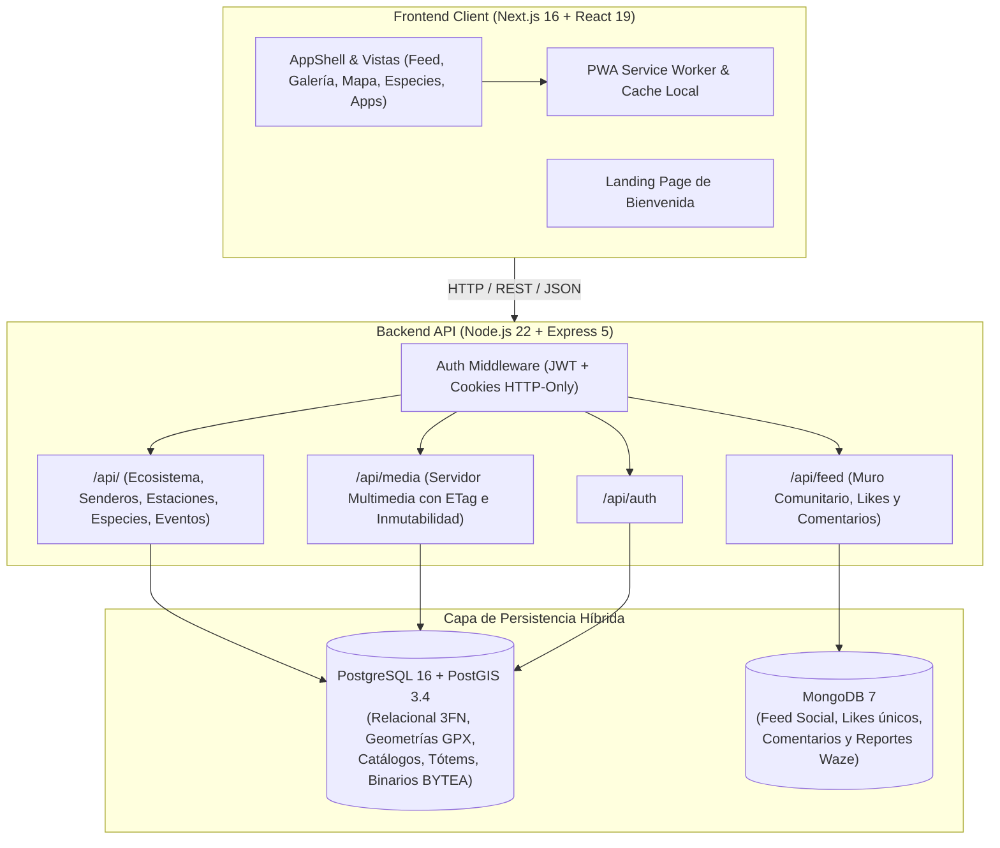
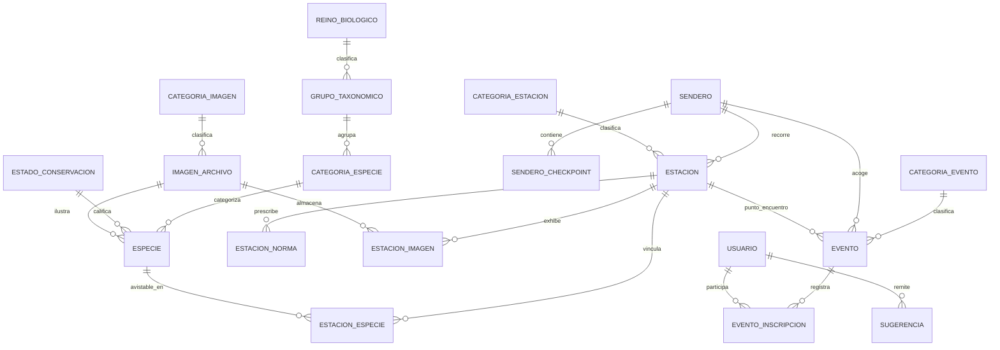

# Arquitectura del Sistema, Base de Datos y Endpoints API
## Santuario de la Naturaleza Humedales de Angachilla (Valdivia)

Este documento detalla la arquitectura técnica integral, el modelo de datos relacional (PostgreSQL/PostGIS) y no relacional (MongoDB), el catálogo de endpoints de la API REST y las optimizaciones de rendimiento implementadas en el sistema.

---

## 1. Visión General de la Arquitectura

El sistema implementa una **arquitectura híbrida distribuida**, desacoplando las entidades con fuerte rigor transaccional y espacial de aquellas con dinámicas sociales y de alta concurrencia.



### Componentes Principales
1. **Frontend Web & Móvil (`frontend/web`)**: Construido con **Next.js 16.4 (Turbopack)**, **React 19**, **Tailwind CSS**, componentes accesibles nativos (`<dialog>`), iconografía vectorial **Lucide**, y PWA con capacidad offline para áreas con baja cobertura celular dentro de la reserva.
2. **Backend API (`backend`)**: Desarrollado en **Express 5** sobre **Node.js 22**, con manejo de sesiones seguras por cookies firmadas, middleware de roles (`visitante`, `socio`, `admin`) y soporte de cargas binarias directas a base de datos.
3. **Base de Datos Relacional (`PostgreSQL 16 + PostGIS 3.4`)**: Alberga el núcleo formal de la reserva: taxocenosis normalizada en 3FN, senderos georreferenciados (geometrías `LINESTRING`), tótems/estaciones con coordenadas exactas (`ST_Point`), inscripciones de eventos y el repositorio binario deduplicado de medios multimedia (`imagen_archivo`).
4. **Base de Datos Documental (`MongoDB 7`)**: Alberga las interacciones sociales dinámicas: publicaciones del muro vecinal, reportes comunitarios de senderos, pines geolocalizados de la galería y el registro de likes con restricción estricta de 1 like por usuario.

---

## 2. Modelo de Base de Datos PostgreSQL (Normalización 3FN & PostGIS)

El esquema relacional fue estructurado en Tercera Forma Normal (3FN), eliminando dependencias transitivas y atributos multivaluados mediante tablas de catálogo y tablas puente.



### 2.1 Tablas de Catálogo y Taxonomía (3FN)
* **`reino_biologico`**: Dominios biológicos principales (`Plantae`, `Animalia`, `Fungi`).
* **`grupo_taxonomico`**: Clases zoológicas y botánicas (`Aves`, `Anfibios`, `Mamíferos`, `Peces`, `Flora Arbórea`, `Helechos`, `Micología`).
* **`categoria_especie`**: Subcategorías operativas para filtros rápidos en la guía de especies.
* **`estado_conservacion`**: Categorías de amenaza según estándar UICN y RCE Chile (`CR` Crítico, `EN` En Peligro, `VU` Vulnerable, `NT` Casi Amenazado, `LC` Preocupación Menor).

### 2.2 Entidades Principales del Ecosistema
* **`especie`**:
  * Identificadores: `id` (UUID), `slug`, `nombre_comun`, `nombre_cientifico`.
  * Atributos ecológicos: `descripcion`, `rol_ecologico`, `habitat`, `estrato`, `reino_id`, `grupo_id`, `categoria_id`, `estado_conservacion_id`.
  * Multimedia asociado: `ilustracion_id` (FK a `imagen_archivo`, exclusivo ilustraciones oficiales PNG), `foto_id` (FK a `imagen_archivo`).
* **`sendero`**:
  * Trazados espaciales: `geometria` (PostGIS `GEOMETRY(LineString, 4326)`), `lat_inicio`, `lng_inicio`, `distancia_km`, `desnivel_m`, `minutos_estimados`, `dificultad`, `es_circuito`, `color_hex`.
  * Auditoría y procedencia: `autor_gpx`, `url_fuente`, `fecha_grabacion`.
* **`sendero_checkpoint`**: Hitos de navegación paso a paso (*turn-by-turn*) con instrucciones de orientación y alertas de seguridad.
* **`estacion` (Los 9 Tótems Interpretativos)**:
  * Localización: `codigo` (S1..S6, E7..E9), `slug`, `nombre`, `subtitulo`, `ubicacion` (`GEOMETRY(Point, 4326)`), `lat`, `lng`, `sendero_id`, `orden`.
  * Interacción en terreno: `codigo_qr`, `sound_key` (paisaje sonoro de aves), `categoria_id`.
* **`estacion_norma`**: Normas y recomendaciones de cuidado ambiental específicas para cada estación en 1FN (eliminando arrays no atómicos).
* **`estacion_imagen`**: Fotografías reales de cada estación vinculadas a `imagen_archivo` con orden de visualización en carrusel.
* **`estacion_especie`**: Tabla puente muchos a muchos con campo `abundancia` y `estacionalidad`.
* **`evento`**:
  * Actividades de la reserva con fecha, hora, ubicación, cupos (`capacidad`), `inscritos_base`, organizador, categoría, y claves foráneas opcionales a `ruta_id` y `estacion_id`.
* **`evento_inscripcion`**: Registro transaccional de usuarios inscritos por actividad, impidiendo sobrecupos e inscripciones duplicadas mediante restricción `UNIQUE(evento_id, usuario_id)`.

### 2.3 Repositorio Binario Multimedia (`imagen_archivo`)
Toda la multimedia oficial y de usuarios se gestiona directamente en PostgreSQL para garantizar consistencia atómica y portabilidad en contenedores:
* Columnas: `id` (UUID), `slug` (VARCHAR único indexado), `nombre_original`, `categoria_id`, `mime_type`, `bytes` (BYTEA), `tamano_bytes`, `sha256` (deduplicación binaria), `subido_por`, `creado_en`.
* Restricciones de unicidad: `UNIQUE(sha256)` evita duplicar archivos idénticos; `UNIQUE(slug)` permite resolver URLs semánticas como `/api/media/slug/sp-chucao`.

---

## 3. Modelo NoSQL MongoDB (Colecciones Comunitarias)

MongoDB 7 almacena las interacciones sociales de alta frecuencia:

### 3.1 Colección `feed_posts`
Documentos polimórficos que alimentan el Muro Comunitario, la Galería y los Pines del Mapa:
```json
{
  "_id": "ObjectId('...')",
  "type": "post | photo_pin | alert | announcement",
  "title": "Laguna de los Pinos y helechos Costilla de Vaca",
  "summary": "Avistamiento de Rana Grande Chilena en la pasarela poniente.",
  "author": {
    "id": "uuid-autor",
    "name": "Comité Ecológico Claro de Luna",
    "role": "admin",
    "avatar": "/api/media/slug/avatar-admin"
  },
  "routeSlug": "ruta-circuito",
  "stationCode": "S2",
  "coordinates": [-39.8571, -73.2392],
  "mediaUrl": "/api/media/slug/estacion-s2-foto-1",
  "likesCount": 14,
  "commentsCount": 3,
  "isPinned": false,
  "moderationStatus": "approved",
  "createdAt": "2026-10-22T15:30:00Z"
}
```

### 3.2 Colección `post_likes` (Restricción de 1 like por usuario)
* Estructura: `{ postId: "id_post", userId: "id_usuario", createdAt: ISODate() }`
* Índice Único: `db.post_likes.createIndex({ postId: 1, userId: 1 }, { unique: true })`
* Comportamiento: Si el usuario ya dio like, la petición subsiguiente remueve el like (toggle atómico con `$inc: { likesCount: -1 }`).

### 3.3 Colección `post_comments`
* Estructura: `{ postId: "...", authorId: "...", authorName: "...", authorAvatar: "...", text: "...", createdAt: ISODate() }`
* Índices: `db.post_comments.createIndex({ postId: 1, createdAt: -1 })`

### 3.4 Colección `route_live_alerts`
Reportes comunitarios georreferenciados estilo Waze en los senderos (`fauna`, `barrier`, `mud`, `viewpoint`, `info`), con vigencia temporal y confirmación por votos de otros visitantes.

---

## 4. Catálogo Completo de Endpoints de la API

La API se sirve en el puerto `4000` con prefijo `/api`.

### 4.1 Autenticación y Usuarios (`/api/auth` y `/api/usuarios`)
| Método | Endpoint | Auth Requerida | Descripción |
| :--- | :--- | :--- | :--- |
| `POST` | `/api/auth/register` | Pública | Registro de nuevos usuarios con hash bcrypt |
| `POST` | `/api/auth/login` | Pública | Login con emisión de cookie HTTP-Only `token` (JWT) |
| `POST` | `/api/auth/logout` | Sesión activa | Invalidación y borrado de cookie de sesión |
| `GET` | `/api/auth/me` | Sesión activa | Retorna los datos y rol del usuario autenticado |
| `GET` | `/api/usuarios` | Administrador | Listado de usuarios registrados |
| `PATCH`| `/api/usuarios/:id/role`| Administrador | Actualización de rol (`visitante`, `socio`, `admin`) |

### 4.2 Repositorio Multimedia (`/api/media`)
| Método | Endpoint | Caché | Descripción |
| :--- | :--- | :--- | :--- |
| `GET` | `/api/media/slug/:slug` | `max-age=31536000, immutable` | Entrega binaria optimizada por slug (con validación de ETag) |
| `GET` | `/api/media/:id` | `max-age=31536000, immutable` | Entrega binaria por UUID |
| `GET` | `/api/media/list` | Pública | Listado de metadatos de imágenes por categoría |
| `POST` | `/api/media` | Sesión activa | Carga de imagen en Base64/DataURL hacia PostgreSQL |

### 4.3 Ecosistema, Territorio y Actividades (`/api`)
| Método | Endpoint | Auth | Descripción |
| :--- | :--- | :--- | :--- |
| `GET` | `/api/taxonomia` | Pública | Catálogos completos: reinos, grupos, categorías y estados UICN |
| `GET` | `/api/estaciones` | Pública | Las 9 estaciones oficiales con normas 1FN, fotos y especies asociadas |
| `POST` | `/api/estaciones` | Admin | Creación de nueva estación con coordenadas PostGIS |
| `PUT` | `/api/estaciones/:id` | Admin | Edición integral de estación |
| `DELETE`| `/api/estaciones/:id` | Admin | Eliminación de estación y desvinculación |
| `GET` | `/api/especies` | Pública | Guía de especies con filtros por reino, grupo taxonómico y búsqueda |
| `POST` | `/api/especies` | Admin | Registro de nueva especie nativa |
| `PUT` | `/api/especies/:id` | Admin | Edición de ficha de especie |
| `DELETE`| `/api/especies/:id` | Admin | Eliminación de especie |
| `GET` | `/api/senderos` | Pública | Los 2 circuitos oficiales con coordenadas GPX decodificadas y checkpoints |
| `GET` | `/api/galeria-oficial` | Pública | Fotografías oficiales de estaciones y senderos |
| `GET` | `/api/eventos` | Pública | Actividades de la reserva con conteo de inscritos y cupos |
| `POST` | `/api/eventos/:id/inscribir` | Sesión activa | Inscripción/desinscripción atómica a una actividad |
| `POST` | `/api/eventos` | Admin | Creación de evento vinculado a ruta o estación |
| `PUT` | `/api/eventos/:id` | Admin | Modificación de fechas, cupos o detalles de actividad |
| `DELETE`| `/api/eventos/:id` | Admin | Cancelación de actividad |
| `GET` | `/api/sugerencias` | Pública | Buzón ciudadano con estados de revisión comunitaria |
| `POST` | `/api/sugerencias` | Pública | Envío de sugerencia o reporte al Comité Ecológico |
| `GET` | `/api/donaciones` | Pública | Opciones y canales de transferencia oficial para la reserva |

### 4.4 Feed Comunitario y Moderación (`/api/feed`)
| Método | Endpoint | Auth | Descripción |
| :--- | :--- | :--- | :--- |
| `GET` | `/api/feed` | Pública | Feed cronológico de publicaciones, fotos de galería y avisos |
| `POST` | `/api/feed` | Sesión activa | Creación de post, pin fotográfico o alerta en el humedal |
| `POST` | `/api/feed/:id/like` | Sesión activa | Toggle de like único por usuario |
| `POST` | `/api/feed/:id/comments` | Sesión activa | Agregar comentario a una publicación |
| `GET` | `/api/feed/alertas-ruta` | Pública | Alertas de senderos activas geolocalizadas |
| `POST` | `/api/feed/alertas-ruta` | Sesión activa | Creación de reporte en tiempo real de la ruta |
| `PATCH`| `/api/feed/:id/moderar` | Admin | Aprobación o rechazo de publicaciones en moderación |
| `DELETE`| `/api/feed/:id` | Autor / Admin | Eliminación de publicación |

---

## 5. Pipeline de Optimización Multimedia

Para solucionar la sobrecarga de peso que ralentizaba la aplicación:
1. **Compresión Adaptada al Tipo de Medio**:
   * **Texturas Vivas de Fondo**: Redimensionadas a `1200px` máximo con compresión JPEG calidad 80 y limpieza de metadatos EXIF (`-strip`). El tamaño se redujo de **47 MB a 1.2 MB** (ahorro del 97.4%).
   * **Fotografías de Estaciones en Terreno**: Redimensionadas a `1280px` máximo calidad 80. Pasaron de **~8.5 MB cada una a ~300 KB**.
2. **Caché HTTP Agresiva**:
   * Las rutas `/api/media/slug/*` y `/api/media/*` entregan la cabecera:
     ```http
     Cache-Control: public, max-age=31536000, immutable
     ETag: "sha256-hash-del-binario"
     ```
   * Cuando el navegador solicita nuevamente la imagen, la API valida `If-None-Match` y responde `304 Not Modified` con carga útil nula (0 bytes).

---

## 6. Procedencia Oficial de los Datos

* **Senderos GPX**: Trazados registrados en terreno por Gonzalo Gallardo (`angachilla-circuito.gpx` y `angachilla-bosque-los-canelo-circuito.gpx`), con cotas de elevación, distancias y tiempos de marcha reales.
* **Textos de la Reserva**: Extraídos directamente de `NUESTRA RESERVA COMUNITARIA.docx` (las 20 hectáreas de superficie, acreditación Ramsar de julio 2025, premio Valdivia Destaca 2026, 8 atracciones y 8 normas de cuidado) y `COMITE ECOLÓGICO.docx` (fundación en 2020 en Claro de Luna, Corporación Humedales de Angachilla y las 5 líneas de acción).
* **Biodiversidad**: Las 69 especies locales catalogadas corresponden estrictamente a las 50 ilustraciones botánicas oficiales PNG de `utilidad/ILUSTRACIONES ESPECIES/` más las 19 especies documentadas en las fichas de estaciones oficiales `TEXTO S 1.odt` a `TEXTO S 6.odt`.
* **Fotografías**: Cero fotografías falsas o descargadas de internet; únicamente se utilizan las 16 fotografías oficiales tomadas en las estaciones de la reserva.
