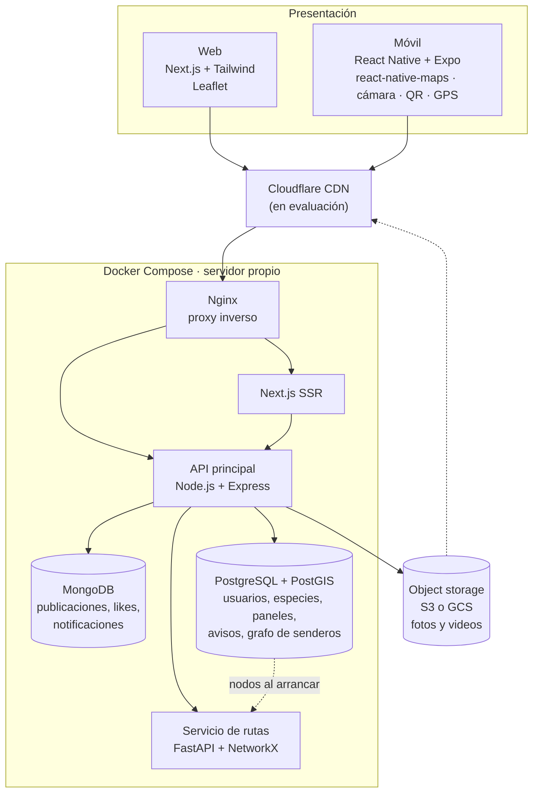

# Humedales Angachilla

Plataforma web y móvil para conocer, recorrer y cuidar los humedales de Angachilla, en Valdivia. Reúne el catálogo de flora y fauna del humedal, un mapa interactivo de los senderos con cálculo de rutas, la versión digital de los paneles informativos (accesibles por QR) y un feed donde la comunidad comparte sus avistamientos.

> **Estado:** en diseño. La arquitectura está definida; el código todavía no está implementado.

## Funcionalidades

| Funcionalidad | Descripción | Requiere cuenta |
|---|---|---|
| Catálogo de especies | Fichas de flora y fauna del humedal, renderizadas en servidor para buen SEO | No |
| Mapa de senderos | Mapa interactivo con los senderos y la posición GPS del visitante | No |
| Rutas | Camino más corto entre dos puntos del sendero (Dijkstra) | No |
| Paneles con QR | Cada panel físico del sendero (8 a 12) tiene un QR que abre su versión digital: información del sector e imágenes de su flora y fauna | No |
| Comunidad | Publicar avistamientos y posts con fotos, comentar y dar like | Sí |
| Avisos | Los administradores publican avisos que llegan como notificación a los usuarios | Sí |

## Arquitectura



### Componentes

| Capa | Tecnología | Responsabilidad |
|---|---|---|
| Web | React, Next.js, Tailwind CSS, Leaflet | Sitio público con SSR, mapa y feed |
| Móvil | React Native con Expo, react-native-maps | App con cámara para publicar, lector QR y GPS |
| Proxy | Nginx | Entrada única: `/` va a Next.js y `/api` a la API |
| API principal | Node.js, Express | Autenticación, subida de imágenes, paneles, comunidad y avisos |
| Servicio de rutas | Python, FastAPI, NetworkX | Carga el grafo de senderos en memoria y calcula el camino más corto con Dijkstra |
| Base relacional | PostgreSQL con PostGIS | Usuarios, roles, catálogo de especies, paneles con su QR, avisos y geometría de los senderos |
| Base documental | MongoDB | Publicaciones de la comunidad, comentarios, likes y notificaciones |
| Archivos | AWS S3 o Google Cloud Storage | Fotos y videos; las bases guardan solo las URLs |
| CDN | Cloudflare (en evaluación) | Caché de contenido estático e imágenes |

### Modelo de datos

**PostgreSQL + PostGIS**

- `rol`, `usuario`: cuentas y permisos (visitante, admin).
- `especie`: catálogo de flora y fauna.
- `panel`, `panel_especie`: versión digital de cada panel físico, su código QR, su ubicación en el sendero y las especies que muestra.
- `nodo_sendero`, `tramo_sendero`: grafo de los senderos (puntos y tramos con su distancia y geometría).
- `aviso`: anuncios publicados por administradores.

**MongoDB**

- `publicaciones`: avistamientos y posts de la comunidad, con fotos, etiquetas y comentarios anidados.
- `likes`: un documento por like, con índice único por usuario y publicación.
- `notificaciones`: bandeja de cada usuario (avisos, likes, comentarios), con expiración automática.

## Estructura propuesta del repositorio

```
humedales-angachilla/
├── apps/
│   ├── web/              # Next.js
│   └── mobile/           # Expo
├── services/
│   ├── api/              # Node.js + Express
│   └── rutas/            # FastAPI + NetworkX
├── infra/
│   └── nginx/            # configuración del proxy
├── docker-compose.yml
└── README.md
```

## Puesta en marcha (propuesta)

Requisitos: Docker y Docker Compose. Para la app móvil, Node.js y Expo.

```bash
git clone https://github.com/cromx123/humedales-angachilla.git
cd humedales-angachilla
cp .env.example .env      # completar credenciales
docker compose up -d      # levanta Nginx, Next.js, API, rutas, PostgreSQL y MongoDB
```

La app móvil se ejecuta aparte:

```bash
cd apps/mobile
npm install
npx expo start
```

PostgreSQL y MongoDB guardan sus datos en los volúmenes `pg_data` y `mongo_data`, así que sobreviven a reinicios de los contenedores.

## Hoja de ruta

- [ ] Esquema de PostgreSQL y carga del grafo de senderos
- [ ] Digitalización de los paneles y generación de sus QR
- [ ] API de autenticación, catálogo y paneles
- [ ] Servicio de rutas con Dijkstra
- [ ] Web con catálogo, mapa y feed
- [ ] App móvil con cámara, lector QR y GPS
- [ ] Comunidad, avisos y notificaciones
- [ ] Despliegue en el servidor y evaluación de Cloudflare

## Licencia

Por definir.
